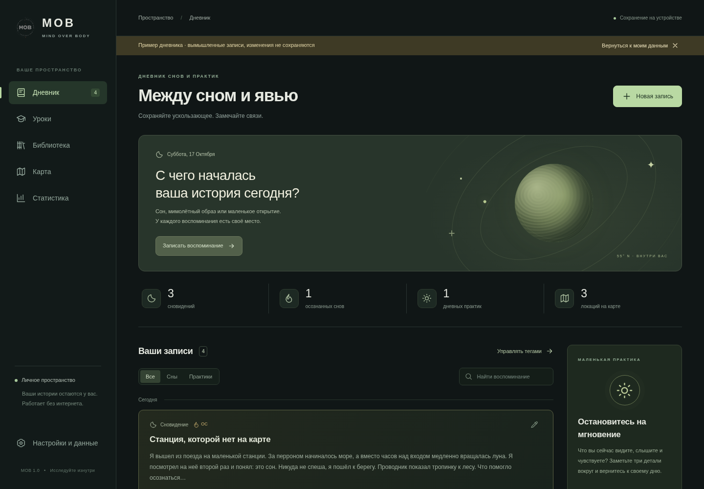
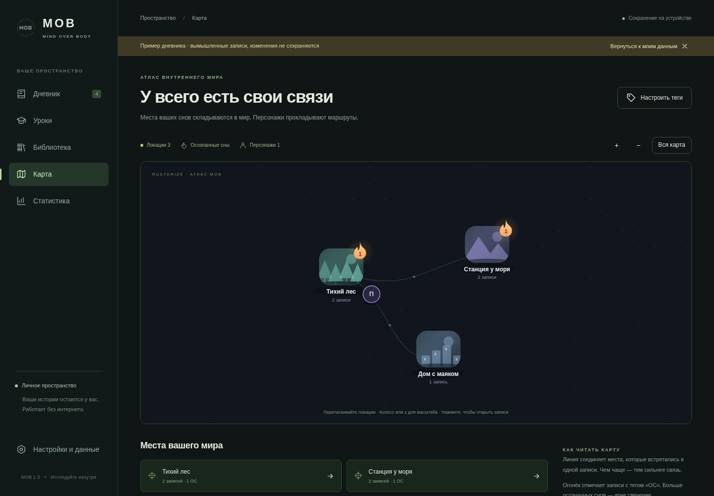

# MOB · Mind Over Body

<p align="center">
  
</p>

<p align="center"><strong>Сохраняйте ускользающее. Замечайте связи.</strong><br>Личный дневник сновидений, атлас внутренних миров и полноценный курс практики.</p>

<p align="center">
<a href="https://usbashka.github.io/MindOverBody/">Открыть приложение</a> ·
<a href="https://github.com/USBashka/MindOverBody/releases/tag/v1.0.1">Скачать Android APK</a> ·
<a href="docs/INSTALL.md">Установка PWA</a> ·
<a href="docs/GOOGLE_DRIVE.md">Подключить Google Диск</a>
</p>

[](https://github.com/USBashka/MindOverBody/actions)



## Ваше пространство

MOB работает локально: без сервера приложения, регистрации, рекламы и аналитики. Записи и иллюстрации сохраняются на устройстве. Дневник, курс, библиотека и карта доступны без интернета. Подключение Google Диска добровольное и используется только для прямой синхронизации ваших данных.

| Раздел | Возможности |
|---|---|
| **Дневник** | Сны и дневные практики, Markdown с просмотром, поиск, фильтры, черновики. Первая запись выбранного дня автоматически становится сновидением; тип можно изменить. |
| **Иллюстрации** | Файлы, камера, вставка из буфера обмена, рисование с цветами, толщиной, ластиком и отменой. Подписи к изображениям. |
| **Теги** | `@тег`, `%тег`, `@[тег с пробелами]`. Модификатор, Локация, Персонаж, Тема, Референс и Результат; описание и своя иллюстрация. |
| **Карта** | Настоящая сцена Rusterize/Rust/WASM. Перемещаемые локации, изображения, связи совместных упоминаний, число записей, огоньки ОС, гуляющие персонажи. Нажатие открывает записи. |
| **Статистика** | Календарь на 12 недель, график снов и практик, доля ОС, дни наблюдений и повторяющиеся образы. |
| **Уроки** | 24 содержательных урока в 12 модулях — более 13 тысяч слов, задания, источники и сохраняемый прогресс. |
| **Библиотека** | 60 справочных статей с поиском по всему тексту, категориями и ссылками. |
| **Данные** | Импорт Somnio без дублей; резервные копии JSON с изображениями; Markdown и CSV; объединение устройств и архив альтернативных версий. |

Демонстрационный режим содержит вымышленные истории и отделён от личного дневника. Приложенный для разработки дневник Somnio **не опубликован**.

## Android и веб

- **Android APK:** отдельное устанавливаемое приложение для Android 8.0+, со встроенными ресурсами, системным выбором файлов, камерой, сохранением резервных копий и Google Play Services Authorization для Drive.
- **Веб/PWA:** современные браузеры с IndexedDB, Canvas и WebAssembly. На Android и компьютере можно установить PWA. После первого открытия приложение кэшируется для офлайн-работы.
- **Данные APK и браузера раздельны.** Для переноса используйте JSON или подключите оба устройства к одному Google Cloud OAuth-проекту и аккаунту Drive.

Оболочка APK — системный Android WebView. Карта выполняет тот же Rust/WASM-код, что и веб-версия; это не прямой нативный Android Canvas/JNI-бэкенд. Дневник и текстовые разделы используют доступный HTML-интерфейс с системной клавиатурой. Подробности: [RUSTERIZE.md](docs/RUSTERIZE.md).



## Google Диск

Код прямой синхронизации реализован. Для реального подключения нужно зарегистрировать OAuth-клиенты в своём Google Cloud: веб-клиент для адреса сайта и Android-клиент для `ru.usbashka.mob` и SHA-1 подписи APK. Секрет клиента или сервер не нужны. Это настройка владельца проекта; без неё Google не разрешит подключение.

В [инструкции](docs/GOOGLE_DRIVE.md) описаны Drive API, согласие пользователя, разрешённый origin и конфигурация Android. Запрашивается только `drive.appdata`. Устройства хранят отдельные снимки в скрытой папке приложения; альтернативные версии сохраняются, токен остаётся в памяти. Синхронизация запускается кнопкой в настройках. Реальный OAuth не входит в автоматические проверки без подключённого Google Cloud-проекта.

## Запустить из исходников

Требуется Node.js 22+. Собранный WASM включён в репозиторий, поэтому Rust не нужен для обычной веб-сборки.

```sh
git clone https://github.com/USBashka/MindOverBody.git
cd MindOverBody
npm ci
npm run build
npm run serve
```

Откройте адрес, напечатанный сервером. Проверка пути GitHub Pages: `npm run serve -- --base /MindOverBody/`.

После изменений Rust-карты:

```sh
rustup target add wasm32-unknown-unknown
npm run build:rust
npm run build
```

Android: [сборка и подпись APK](docs/ANDROID.md). Не публикуйте keystore и пароли. Одинаковая подпись необходима для установки обновлений поверх предыдущей версии без удаления данных.

## Проверки

```sh
npm test
npm run build
npx playwright install chromium
npm run test:e2e
cargo test --manifest-path native/Cargo.toml --locked
cargo clippy --manifest-path native/Cargo.toml --all-targets -- -D warnings
```

Браузерные проверки используют production-сборку по пути `/MindOverBody/`, проверяют desktop/mobile, запись/редактирование/удаление, изображения, рисунки, черновики, теги, фактический WASM, перемещение карты, курс, поиск, экспорт и офлайн. Личный Somnio-файл можно проверить локально через `SOMNIO_FIXTURE=/path/to/export.json npm run test:e2e`; его содержимое не попадает в логи и снимки.

GitHub Actions собирает WASM и веб, запускает проверки, публикует GitHub Pages и проверяет Android APK. [Фактический объём проверок и ограничения](docs/VALIDATION.md).

## Материалы и устройство проекта

| Путь | Назначение |
|---|---|
| `src/app.js`, `styles.css` | Интерфейс и сценарии приложения |
| `src/data.js`, `src/drive.js` | IndexedDB, импорт, версии, слияние и Google Drive |
| `src/media.js`, `src/markdown.js` | Иллюстрации, рисунки и безопасный Markdown |
| `src/content.js` | 24 урока и 60 статей |
| `native/`, `vendor/rusterize/` | Rust-карта и закреплённая версия Rusterize |
| `android/` | Android-оболочка, файловые диалоги, OAuth и подпись |
| `tests/` | Модульные и браузерные проверки |
| [COURSE_DRAFT.md](COURSE_DRAFT.md) | Исходная концепция; текущий продукт описан в этом README |
| [RESOURSES.md](RESOURSES.md) | Исследовательский каталог; историческое написание имени сохранено |
| [COURSE_SOURCES.md](docs/COURSE_SOURCES.md) | Происхождение курса, источники и границы утверждений |
| [PRIVACY.md](docs/PRIVACY.md) | Хранение данных, резервные копии и приватность |

Курс различает научные результаты, практические гипотезы и опыт сообществ. Осознанность во сне, управление сюжетом и яркость образов — разные навыки. Внутренний диалог остаётся добровольной веткой. Прогресс не требует выдумывать успешный опыт.
